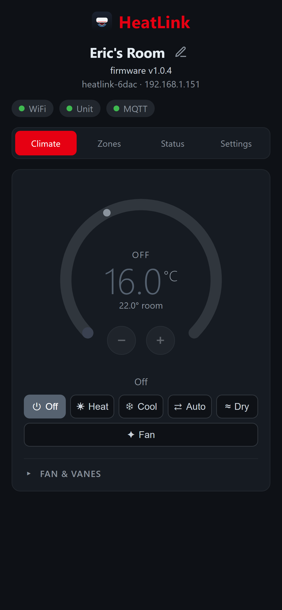
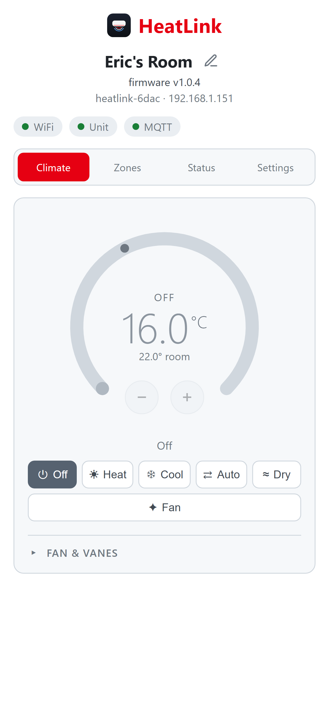
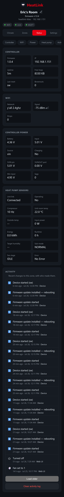
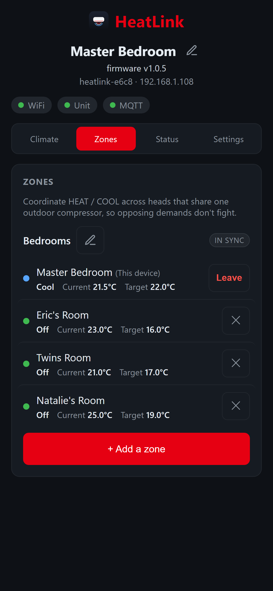
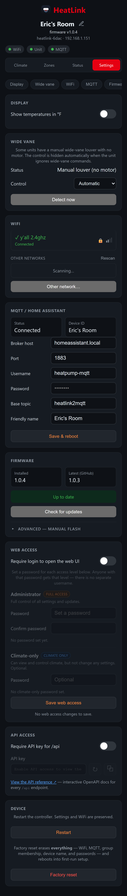

# HeatLink

**A tiny, 100 %-local WiFi controller for Mitsubishi Electric mini-splits — with
a full touch web UI, a documented REST API, native Home Assistant integration,
and one-of-a-kind multi-head zone coordination. No cloud, no subscription, no
proprietary hub.**

HeatLink is ESP-IDF firmware for an **M5Stack Stamp-S3Bat** (ESP32-S3) that talks
to a **Mitsubishi Electric** indoor unit over its **CN105** service port and
bridges it to **Home Assistant over MQTT** — while also serving a polished,
phone-friendly control panel and a clean JSON API directly from the device.

Solder four wires to a CN105 pigtail (the 12 V pin is left unconnected), flash
the board, and you get a thermostat you fully own: it runs on your LAN, survives
internet outages, and exposes every capability over an open API so you can build
whatever front-end you like — a custom WiFi remote, a wall-mounted tablet
dashboard, a physical knob, or a Node/Python automation.

And uniquely, when several indoor heads share one outdoor compressor, HeatLink
units **coordinate their HEAT/COOL demands with each other over your LAN** so
they never fight the shared unit — to our knowledge the first open Mitsubishi
bridge to solve this multi-zone problem.

HeatLink descends from the lineage of
[`mitsubishi2MQTT`](https://github.com/gysmo38/mitsubishi2MQTT) (Arduino/ESP8266)
and the CN105 protocol work in [SwiCago/HeatPump][swicago], rebuilt from the
ground up on ESP-IDF with its own web UI, REST API, and MQTT schema.

<p align="center">
  
  
</p>

## Why HeatLink?

Most Mitsubishi WiFi options are either a cloud adapter (Kumo Cloud / MELCloud —
your thermostat stops working when their servers do) or a bare protocol bridge
with no UI of its own. HeatLink is different:

- 🌐 **100 % local, no cloud, no account.** Everything runs on the device and
  your LAN. Nothing phones home.
- 🧊 **Multi-head zone coordination — a HeatLink first.** When several indoor
  heads share one outdoor compressor, Mitsubishi hardware forces them all into
  the *same* HEAT-or-COOL mode; ask two rooms for opposing modes and they fight
  the compressor. HeatLink units negotiate over your LAN, elect a coordinator,
  and lock the shared unit to one demand — to our knowledge no other open
  Mitsubishi bridge solves this.
- 📱 **A real web UI, not just a bridge.** A responsive touch dashboard —
  temperature dial, mode/fan/vane controls, live status, and settings — served
  straight off the ESP32 at `http://heatlink-<id>.local/`. Light & dark themes,
  iOS-PWA-ready (installable, safe-area aware for notch/Dynamic-Island phones).
- 🔌 **An open, documented REST API + OpenAPI spec.** Every capability the UI
  has is a plain JSON endpoint ([`openapi.yaml`](openapi.yaml), browsable in-app
  via Swagger UI). Build a **custom WiFi remote, a wall controller, a kiosk
  dashboard, or a scripted automation** without touching the firmware.
- 🏠 **First-class Home Assistant.** MQTT auto-discovery publishes a climate
  entity, a firmware **update** entity, and diagnostic sensors/buttons — no YAML.
- ⚡ **Power-integrity diagnostics you won't find elsewhere.** The board runs off
  the CN105 5 V rail, so HeatLink actively monitors and *counts* **brownouts**,
  **input-voltage sags**, and **WiFi drops**, surfaces min-input-voltage and
  battery state, and lets you reset those counters from the UI or Home Assistant.
  A closed-loop **PMIC charge governor** buffers the rail with a small LiPo so the
  module rides through power blips a naked bridge would crash on.
- 🔎 **Capability auto-detection.** Probes the unit (e.g. powered vs. manual
  wide-vane louver) and hides controls the hardware doesn't actually support.
- 🚀 **Painless updates.** OTA via drag-and-drop, HTTPS URL, MQTT, or one-click
  **GitHub self-update**, all with A/B partitions and automatic rollback.
- 📡 **Self-provisioning & self-discovery.** Captive-portal WiFi setup on first
  boot, mDNS hostname, and DNS-SD advertisement so tools can find every unit.

> **Status: working.** Architecture, threading, WiFi (incl. captive-portal
> provisioning + mDNS), the on-device web UI / REST API, the MQTT client +
> Home Assistant discovery (climate + firmware `update` entities), the PMIC I²C
> driver, and the **CN105 packet engine** are all in place; deployed units drive
> real indoor units and report live telemetry. A multi-head **zone coordination**
> layer keeps heads that share one outdoor compressor from fighting over
> HEAT/COOL. CI builds green.

## Hardware

The controller is an off-the-shelf **[M5Stack Stamp-S3Bat][stamp]** module — an
ESP32-S3 (`ESP32-S3-PICO-1-N8R8`, 8 MB flash / 8 MB PSRAM) with an on-board
battery/PMIC subsystem, so a single small LiPo buffers the whole thing off the
heat pump's own 5 V rail. No custom PCB is required; you solder four wires from
its castellated pads to a CN105 cable.

| Part | Role |
|------|------|
| [M5Stack Stamp-S3Bat][stamp] (`ESP32-S3-PICO-1-N8R8`) | application MCU + WiFi |
| M5MP1 PMIC (I²C `0x6E`, on-module) | rails, Li-ion charge gate (`CHG_EN`), VBAT/VIN telemetry |
| LGS4056HDA-4.35 (on-module) | Li-ion charger |
| 400 mAh LiPo ([Adafruit 3898][lipo], SH1.0-2P) | buffer for CN105 power blips + WiFi TX spikes |

[stamp]: https://shop.m5stack.com/products/m5stamps3-bat-module-with-battery-connector
[lipo]: https://www.adafruit.com/product/3898

The CN105 5 V rail is current-limited, so the firmware runs a **closed-loop
charge governor** (`m5pm1::PMIC::governor_tick`) that gates `CHG_EN` on the VIN
reading to keep input draw within budget — that's what lets the module run
directly off CN105 5 V with the LiPo absorbing transients. See
`components/m5pm1/`. Board pinout and schematic: the
[M5Stack Stamp-S3Bat docs][stampdocs].

[stampdocs]: https://docs.m5stack.com/en/core/Stamp-S3Bat

### Default pin map (override in `menuconfig` → *Component config → HeatLink Controller*)

| Function | GPIO | Notes |
|----------|------|-------|
| CN105 UART TX (→ heat pump RX, CN105 pin 5) | **GPIO 1** | UART port 1, 2400 baud 8E1 |
| CN105 UART RX (← heat pump TX, CN105 pin 4) | **GPIO 2** | |
| PMIC I²C SDA / SCL | **48 / 47** | internal bus (per S015 schematic); don't remap |

Defaults live in [`main/Kconfig.projbuild`](main/Kconfig.projbuild)
(`CN105_UART_TX_PIN`, `CN105_UART_RX_PIN`, `CN105_UART_PORT`, `PMIC_I2C_*`).

### CN105 connector & cable

Mitsubishi indoor units expose a 5-pin **CN105** service header. The mating
connector is a **JST PA series, 2.0 mm pitch, 5-position** housing:
[JST **PAP-05V-S**][pap] (the DigiKey part) with **SPH-002T-P0.5S** crimp
terminals. Crimping JST PA by hand is fiddly, so **a pre-made CN105 pigtail is
the easy path**. Ready-to-buy options include this
[pre-terminated CN105 cable on Amazon][amzn] and the pre-wired cables from
[Serin Labs][serin]; or search "Mitsubishi CN105 cable/pigtail" for more.

[pap]: https://www.digikey.com/en/products/detail/jst-sales-america-inc/pap-05v-s/759977
[amzn]: https://www.amazon.com/dp/B0DJT6D67S
[serin]: https://serin-labs.com/wiring.html

**CN105 pinout** (looking at the header on the indoor-unit PCB) and how it maps
to the Stamp-S3Bat:

| CN105 pin | Signal | Wire to Stamp-S3Bat |
|-----------|--------|---------------------|
| 1 | **12 V** | **do not connect** |
| 2 | GND | `GND` |
| 3 | 5 V | `5V`/`VIN` (powers the module + charges the LiPo) |
| 4 | TX (data **from** the heat pump) | **RX** → GPIO 2 |
| 5 | RX (data **to** the heat pump) | **TX** → GPIO 1 |

The data lines are **crossed** — heat-pump TX → ESP RX, heat-pump RX → ESP TX.
The CN105 bus is **5 V TTL** while the ESP32-S3 GPIOs are 3.3 V (not 5 V
tolerant); many builds direct-connect and work, but a small level shifter on the
ESP **RX** line is the electrically-correct choice. Always plug/unplug the
connector with the unit powered **off**, and never wire pin 1 (12 V) to the ESP.

Good background/wiring references (they target ESPHome/Arduino but the wiring and
protocol are identical):

- [SwiCago/HeatPump][swicago] — the original CN105 protocol library this port is based on
- [Serin Labs wiring guide][serin] — CN105 pinout + diagrams
- [ESPHome `mitsubishi_cn105`][esphome] and [echavet/MitsubishiCN105ESPHome][echavet]

[swicago]: https://github.com/SwiCago/HeatPump
[esphome]: https://esphome.io/components/climate/mitsubishi_cn105/
[echavet]: https://github.com/echavet/MitsubishiCN105ESPHome

## Architecture

```
              app_main
                 │
   ┌─────────────┼───────────────┬────────────────┐
   ▼             ▼               ▼                ▼
 m5pm1        wifi_manager    hvac_mqtt          cn105
 (PMIC,       (STA + SoftAP   (esp-mqtt, HA      (Mitsubishi
  charge       provisioning)   discovery, LWT)    CN105 protocol)
  governor)
   │                             ▲   │              │
   │ pmic_task (1 Hz)            │   │ commands     │ cn105_task (10 Hz)
   └────────────────────────────┘   └──────────────┘
```

## MQTT contract

Base: `<base_topic>/<friendly_name>`

| Direction | Topic suffix |
|-----------|--------------|
| subscribe | `/mode/set` `/temp/set` `/remote_temp/set` `/fan/set` `/vane/set` `/wideVane/set` `/system/set` `/ota/set` `/update/install` `/diag/reset_brownout` `/diag/reset_wifi_drops` `/auth/reset_admin` |
| publish | `/state` (retained) `/settings` `/availability` (LWT) `/update/state` (retained) `/diag/state` (retained) `/group/state` (retained) `/debug/packets` `/debug/logs` |
| discovery | `homeassistant/climate/<friendly_name>/config` · `homeassistant/update/<friendly_name>/config` · diagnostic `sensor`/`button`/`binary_sensor` entities (brownout & WiFi-drop counts + reset buttons, admin password reset button, group/conflict state) — all retained |

Beyond the climate entity, Home Assistant auto-discovers **diagnostic sensors**
(brownout count, WiFi-drop count, group/compressor-conflict state) and **reset
buttons** (reset brownout count, reset WiFi drops, reset admin password), so the same diagnostics the
web UI shows are available as native HA entities you can chart, alert, or
automate on.

Discovery can be turned off under Settings → MQTT (or `POST /api/mqtt
{"discovery":false}`). The head then sends an empty retained config for every
discovery topic, so Home Assistant removes the MQTT entities; state topics keep
publishing. Use this once the native HeatLink integration is set up, so each
unit doesn't show up twice.

## Off at setpoint (parking)

Mitsubishi wall heads keep the indoor fan running after they reach their
setpoint (thermo-off), and there is no CN105 command to stop it. With **Settings
→ Off at setpoint** enabled, HeatLink emulates it:

- **Park.** A head in HEAT, COOL or DRY that has been at its setpoint with the
  compressor idle for 60 s is powered off. Its *desired* state stays on: the web
  UI, Home Assistant (`mode: heat`, `action: idle`) and zone peers still see it
  as on. It shows **Parked** on the climate card. Defrost, preheat, warm-up and
  standby never count as "at setpoint". FAN and AUTO never park.
- **Resume.** It powers back on when the room drifts past the setpoint by the
  restart threshold (0.5–3 °C, default 0.5) after the minimum off time
  (5–60 min, default 5; this protects the outdoor unit from short cycling).
- **Air check (probe).** With the fan stopped, the head only senses the air
  around itself. By default it runs every 15 min for 2 min of real airflow
  (preheat time doesn't count) and resumes if the room needs it, else parks
  again. The check runs the fan at its lowest speed (Quiet) and then restores
  your fan setting; a fan change made during a check is kept. The interval is never shorter than the minimum off time.
- **Your commands win.** Turning a head off makes it really off (it is never
  re-parked or probed). Changing the mode or setpoint while parked starts an air
  check. Turning the feature off while parked powers the unit back on. The
  parked state survives a reboot.

**Outdoor-unit settings.** In a zone group the on/off switch, minimum off time
and air-check settings belong to the outdoor unit: saving them on any head
(admin) applies them to every head in the group, and a head that joins adopts
them. The restart threshold stays per head. Until the group's settings are
first saved, each head keeps its own.

Home Assistant gets `parked`/`park_state` in the climate entity's attributes and
a **Parked** binary sensor. Park/resume transitions are written to the activity
log; routine air checks aren't.

Limitations:
- Pressing **OFF on the IR remote while a head is parked** can't be detected
  (the unit is already off), so the next air check turns it back on. Use the
  web UI or HA to turn a parked head off. Pressing ON on the remote while parked
  is detected and starts an air check.
- As before, remote presses within 30 s of a HeatLink command are reverted.

## Tandem: heating and cooling on one outdoor unit

All heads on one outdoor unit share its direction: it can heat or cool, not
both. Normally, picking Heat or Cool while another zone runs the opposite
direction asks for confirmation, names those zones, and turns them **off**
(their modes are left alone) so this head gets the unit. With **Settings → Tandem** enabled (admin, needs every head online and
on firmware that supports it), the group instead takes turns heating and cooling
(time-slicing):

- The online head with the lowest uid is the coordinator (the same election
  as zone polling; another head takes over within ~45 s if it drops off). It
  publishes the current turn — HEAT or COOL — in its signed group snapshot.
- Heads that want the served mode run normally (with off-at-setpoint). Heads
  that want the other mode keep that mode but are held **parked** (shown as
  "Paused while other rooms heat/cool") until their turn. Once a waiting room
  needs its turn, its Climate tab shows when that turn will start: "cooling
  within N min" (the latest the running turn can end) or, during the pause
  between modes, "cooling starts in ~N min". HeatLink doesn't
  change a head's mode to slice (except briefly to FAN for the air check below).
- A turn lasts at least the **minimum turn** (5–60 min, default 10; protects
  the outdoor unit from short cycling). After that it may hand over once every
  head in the current mode is satisfied, and is reconsidered at the **maximum
  turn** (default 30 min). Either way the turn is handed over only if a waiting
  room **needs** it (its room is past its restart threshold, the
  off-at-setpoint delta); otherwise the current turn carries on for another
  maximum turn and the activity log says so ("kept heating — rooms waiting to
  cool don't need it yet"). A mode nobody wants any more ends its turn at once.
- How a waiting head knows whether its room needs a turn: with a room sensor
  it just reads it. Without one, the head's own sensor sits in still air, so
  shortly before the decision (the air-check duration + 1 min ahead) it runs an
  **air check in FAN mode** at QUIET fan — the compressor never runs the wrong
  way — then powers off and restores its mode. The verdict is good for 10 min;
  while the current turn's rooms are all satisfied the waiting rooms are
  re-checked every 10 min. The coordinator waits up to 5 min past the decision
  for a check still running, then hands over. A room that starts waiting late
  in a turn (or after the max) still gets time for its check. If air checks
  are disabled, or a
  head runs older firmware, a waiting room counts as needing its turn.
  Between modes every head is parked for the **pause between modes** (3–10 min,
  default 3; a safety margin in case the outdoor unit has no restart delay of
  its own). The turn clock pauses during defrost and never switches mid-defrost.
- Off-at-setpoint is forced on for every head while Tandem is enabled. DRY
  counts as cooling; OFF and FAN heads are unaffected.
- **Auto** works as a heat-to/cool-to range (see below). Turning a waiting head
  on from the IR remote re-parks it.
- `/api/group/resolve`, `/api/group/sync` and the "switch all zones" prompt are
  disabled; mixed modes are expected rather than a conflict.

### Auto under Tandem

The unit's own AUTO picks heat or cool itself, which fights the turns. Under
Tandem, **AUTO is HeatLink's range** instead: you set a **heat-to** and a
**cool-to** temperature (at least 2 °C apart, 16–31 °C) and the unit physically
runs HEAT at heat-to or COOL at cool-to, so it takes part in the turns like any
other room. The web UI shows a dial with two thumbs; `/api/settings` reports it
under `auto` (`heat_to`, `cool_to`, `dir`) and accepts `heat_to`/`cool_to`.

- **Switching.** The room temperature is read from a trusted sample: a room
  sensor, the end of an air check, or the head running with the fan on for the
  air-check duration. Heating switches to cooling once the room reaches cool-to
  plus the restart threshold (and the reverse), at most once a minute. There is
  no fixed hold time; the 2 °C gap plus the threshold is the hysteresis.
- **Setpoint.** Changing the setpoint (UI, HA, IR remote) moves the end in use;
  the other end moves if needed to keep the gap. Choosing HEAT/COOL/DRY/FAN
  leaves Auto; OFF keeps it.
- **Turning Tandem on/off.** A head in the unit's own AUTO becomes a range
  around its setpoint (±1 °C). Turning Tandem off returns a managed head to the
  unit's own AUTO at the middle of the range. Pressing AUTO on the IR remote
  under Tandem also starts the range.
- Outside Tandem, AUTO is the unit's own Auto, unchanged.

## Room sensors

Each head can use up to **4** battery-powered sensors on the wall as its room
temperature instead of the air at the head; with several, it uses the average
of those that are fresh. Sensors come from drivers by transport:

| Driver | Devices | How readings arrive |
| --- | --- | --- |
| Bluetooth (BTHome) | any **unencrypted BTHome v2** sensor, e.g. Shelly BLU H&T | passive scan of its adverts (about every minute) |
| Shelly Wi-Fi | Shelly Gen2+ devices with a temperature sensor, e.g. Shelly H&T Gen3 | webhooks the head installs on the sensor call `GET /api/sensors/report` |

- **Pairing** (Settings → Room sensors, admin): tap *Add sensor* and pick the type.
  - *Bluetooth*: press the button on the sensor within 60 s, or pick it from
    the sensors heard nearby. Bluetooth only scans while a Bluetooth sensor is
    paired or pairing.
  - *Wi-Fi*: wake the sensor (open its back cover, press the button) and pick
    it from the list found on the network, or type its IP address. The sensor
    must have no password. The head replaces any earlier HeatLink webhooks on
    the sensor, so a sensor feeds one head.
- **Report step** (Wi-Fi sensors): a battery Shelly H&T sleeps and reports
  only when the temperature moves by this much (default 0.5 °C) or at least
  every 2 h. Changes apply the next time the sensor wakes; press its button to
  apply at once. Webhooks are re-pointed automatically if the head's IP changes.
- While any reading is fresh the head sends the room temperature to the unit
  as its remote room temperature (Home Assistant's `remote_temp/set` is ignored
  meanwhile), and off-at-setpoint uses it directly, so no fan air checks run.
  Changing the target while parked re-evaluates against the sensors at once.
- A sensor is stale after **10 minutes** (Bluetooth) or **2 h 15 min** (Wi-Fi)
  without a reading. With none fresh, the head clears the remote temperature,
  goes back to its own sensor and air checks, and shows a warning. It switches
  back automatically when readings resume.
- Encrypted BTHome sensors can't be read; turn encryption off in the Shelly app.

## Build / flash

ESP-IDF **v6.1** (matches CI; `>=6.0` required).

```bash
# one-time, or after cleaning
idf.py set-target esp32s3

# bench config: copy and edit local creds (gitignored)
cp sdkconfig.defaults.local.example sdkconfig.defaults.local

idf.py build
idf.py -p <PORT> flash monitor
```

WiFi can be set at build time (`sdkconfig.defaults.local` / `menuconfig`) or at
runtime (NVS, via the captive-portal SoftAP). On first boot with no credentials
the device starts a `heatlink-XXXX` SoftAP (captive portal at
`http://192.168.4.1/`); pick a network and enter the passphrase, and it saves to
NVS and reboots into STA mode. The **MQTT broker** is **not baked into the
firmware** by default (open-source builds ship with no broker), so on first boot
a fresh unit comes up unconfigured and you enter the broker at runtime from the
web UI (**Settings → MQTT / Home Assistant**), persisted to NVS; saving reboots the
device. Additional units can instead **inherit** the broker by joining an
existing group. (Personal builds may still bake a default broker via
`CONFIG_MQTT_BROKER_URI` in `sdkconfig.defaults.local`.) Each unit derives a short
hardware-unique id from its factory MAC (e.g. `E608`) that is reused everywhere
so multiple units never collide: the SoftAP name (`heatlink-<id>`),
the **mDNS hostname** (`heatlink-<id>.local`), and the default MQTT
node (leaving `friendly_name` blank yields `heatlink-<id>`). The same id is the
HA `unique_id`/device identity. Units are also **self-discoverable** via DNS-SD:
each advertises an `_http._tcp` service with TXT records (`id`, `fw`, `model`,
`path`), so `avahi-browse -rt _http._tcp` / Bonjour / a controller can list every
unit without knowing the hostname.

### Admin password

A freshly provisioned head is **locked until you create an admin password**.
The portal's success screen shows the head's address with a one-time claim
link (`http://heatlink-<id>.local/?claim=…`). Opening it first lists the outdoor
units already on your network (the one whose compressor frequency matches this
head's is marked *Likely*): pick yours and enter that unit's admin password to
join it, and the head adopts that password. If you pick *A different outdoor
unit*, or no other heads are found, you create a new admin password instead.
Once set, settings need the admin login. Climate control (temperature, mode, fan,
vanes) is open to anyone on your network unless you set the optional per-head
**climate-only password** (Settings → Web access); visitors use the corner
*Sign in* icon for admin. With a climate-only password set, the sign-in screen
takes either password and the one entered decides the access level. Heads upgraded from older firmware without a password
stay open and show a banner asking you to set one.

Climate-only users (e.g. renters) see the **Climate**, **Zones** (read-only) and
**History** tabs. Under Web access the admin can also **limit the temperature
range** climate-only users can set, and turn off **Reset by cutting power** so
anyone with breaker access can't reset the admin password (the Home Assistant
button still can). Both are per head; MQTT/Home Assistant and API-key clients
are not limited.

**Forgot the admin password?** Unless it was turned off, run the reset procedure: **cut power to the head
5 times, with less than 30 s between cuts** (each time, power it back on and
cut it again within 30 s). On a head without a battery a power-on reset counts
as a cut; with a battery, the input dropping out for 2 s or more and coming
back counts. The Home Assistant **Reset admin password** button does the same
thing. Either way, for the next **15 minutes** anyone who opens the web UI can
set a new admin password without logging in; doing so also signs everyone out
and rotates the API key and revokes integration tokens. The old password keeps working meanwhile, and if no
new one is set within the window nothing changes. Wi-Fi, MQTT and the
climate-only password are never touched.

**One password per outdoor unit.** All heads on an outdoor unit share the admin
password. A head joins a group (setup, the setup wizard, or **Settings → Outdoor
unit**) by proving it knows the group's admin password, which is never sent: the
joining head sends an HMAC proof keyed by the password hash, and the group's
secrets come back encrypted under a key derived from it. Changing the password on
any head syncs it to the rest of the group (the newest change wins), carried
encrypted in the signed peer polls. A head upgraded without a password adopts its
group's password the same way.

**Moving between zones.** When you're signed in as admin, opening another zone
from the **Zones** tab signs you in there too. Your head signs a one-time ticket
with the group key. The ticket is valid for 60 s, and the other head trades it for
its own admin session. This needs the heads' clocks set (NTP). The climate-only
password is set per head, so climate-only sign-ins don't carry over.

## Web UI / REST API

Once connected to WiFi the device serves a responsive touch dashboard at
`http://<ip>/` (or `http://heatlink-<id>.local/` via mDNS, where `<id>` is the
unit's MAC suffix shown on the Status tab). It has five tabs — **Climate**
(temperature dial, mode, fan & vanes), **Zones** (multi-head pairing &
coordination with live Tandem status, plus a **House** view listing every head on the LAN grouped by
outdoor unit when you have more than one), **History** (admin only — a chart of
room/target/outdoor temperature and heating/cooling/defrost/parked bands
over 4 h, 24 h or 7 days (7 days on wider screens only; phones open on 4 h, wider screens on 24 h); one sample every 30 s is kept on flash for
14 days and survives reboots and OTA), **Status** (live diagnostics — WiFi, controller power, heat-pump
sensors, activity log), and **Settings** (display, wide-vane, off at setpoint,
Tandem, WiFi, MQTT/HA,
firmware, web/API access, device reset). It works standalone as a thermostat, or
alongside MQTT/Home Assistant.

<table>
  <tr>
    <td align="center" valign="top" width="33%"><b>Status &amp; diagnostics</b><br><br></td>
    <td align="center" valign="top" width="33%"><b>Zones (multi-head)</b><br><br></td>
    <td align="center" valign="top" width="33%"><b>Settings</b><br><br></td>
  </tr>
</table>

Everything the UI does is backed by the same JSON API — so you can drive the unit
from a script, a wall panel, or your own front-end. The full contract lives in
[`openapi.yaml`](openapi.yaml):

**▶ [Browse the REST API in Swagger UI](https://petstore.swagger.io/?url=https://raw.githubusercontent.com/sslivins/heatlink/main/openapi.yaml)** — an interactive viewer for every `/api` endpoint.

The same reference is available in-app (Swagger UI, linked from **Settings → API
access**). Optional per-endpoint API-key auth can be enabled there.

**Integration tokens.** For Home Assistant or scripts, create a token under
**Settings → API access → Integration tokens** (or `POST /api/tokens`) and send it
as `Authorization: Bearer hlt1_…`. Each token has a name, shown in the activity
log for what it changes, and a scope: **read only** (GET requests), **climate
control** (same as the climate-only login) or **full admin**. A head holds up to
8 tokens, stores only their hashes and shows each one once. Tokens work whether
or not the API key is required, can be revoked one at a time, and are all revoked
when the admin password is reset. A token that is sent but invalid gets 401 even
where the endpoint would otherwise be open. `GET /api/info` is public and reports
the head's identity and `api_version` for discovery.

One token covers a whole outdoor unit: with it, `POST /api/tokens/ticket
{"uid"}` returns a one-time ticket (valid 60 s) for another head in the group,
and `POST /api/tokens/redeem {"ticket","label"}` on that head exchanges it for
its own token with the same name and scope. Redeeming again replaces the
earlier token of that name instead of adding another.

An outside room temperature (from Home Assistant, say) goes through `POST
/api/remote-temp`. It's a lease: if updates stop, the head goes back to its own
sensor after `ttl_s` and logs it, so a dead integration can't leave the unit on
a stale reading. `remoteTemp` in `/api/settings` and the MQTT `remote_temp`
topic still work and never expire. A paired room sensor takes priority over
both. `GET /api/settings` shows the active feed as `remoteTemp`, and `fault` is
true while the unit reports an error code.

### Control & status

| Method | Path | Purpose |
|--------|------|---------|
| `GET`  | `/` | gzip'd dashboard |
| `GET`  | `/api/status` | version, ip, ssid, uptime, free heap, unit/MQTT link, PMIC power telemetry, diagnostics (brownout/WiFi-drop counts, sags, min VIN) |
| `GET`  | `/api/settings` | current heat-pump settings + status |
| `POST` | `/api/settings` | apply any subset of `{power,mode,temperature,fan,vane,wideVane,remoteTemp}` |
| `POST` | `/api/remote-temp` | feed an outside room temperature (`{temp,ttl_s}`, `temp:null` stops); lapses after `ttl_s` (default 600 s) |
| `GET`  | `/api/capabilities` | detected unit capabilities (e.g. wide-vane) + override |
| `POST` | `/api/capabilities` | trigger a capability probe / set an override |
| `GET`  | `/api/park` | off-at-setpoint config + live status (`shared_fields` lists what a write changes for the whole group) |
| `POST` | `/api/park` | (admin) update off-at-setpoint config (partial; values are clamped) |
| `GET`  | `/api/sensor` | wireless room sensor: pairing state, latest reading, nearby sensors while pairing |
| `POST` | `/api/sensor` | (admin) `{"action":"pair"|"cancel"|"select"|"remove"}` (`select` takes `addr`) |
| `GET`  | `/api/events` | activity log (who changed what, paginated) |
| `DELETE` | `/api/events` | clear the activity log |
| `GET`  | `/api/history?window=&end=` | (admin) recorded history window (14 days at 30 s, bucketed for long windows) |

### Diagnostics

| Method | Path | Purpose |
|--------|------|---------|
| `POST` | `/api/diag/reset-brownout` | reset the persisted brownout counter |
| `POST` | `/api/diag/reset-wifi-drops` | reset the WiFi-drop counter |

### Provisioning & configuration

| Method | Path | Purpose |
|--------|------|---------|
| `GET`/`POST` | `/api/mqtt` | broker settings `{host,port,username,base_topic,friendly_name,…}` (password never returned; POST saves to NVS + reboots) |
| `GET`/`POST` | `/api/wifi` | network settings `{ssid,mode,connected,ip,…}` (POST saves to NVS + reboots) |
| `GET`  | `/api/scan` | scan for nearby WiFi networks |
| `POST` | `/api/device` | set the unit's friendly name / device identity |
| `GET`/`POST` | `/api/auth` | admin/climate-only passwords, API-key gating, and the first-password claim (see [Admin password](#admin-password)) |
| `GET`/`POST`/`DELETE` | `/api/tokens` | admin: list · create (`{label,scope}`, token shown once) · revoke (`?id=`) integration tokens |
| `POST` | `/api/tokens/ticket` | token only: one-time ticket (`{uid}`) for the same token on another head in the group |
| `POST` | `/api/tokens/redeem` | no auth: exchange a ticket (`{ticket,label}`) for this head's own token |
| `GET`  | `/api/info` | **unauthenticated** identity for discovery: uid, name, firmware, `api_version`, sign-in methods, features |
| `POST` | `/api/login` · `/api/logout` | web-UI session auth (10 failed logins lock it for 30 s) |
| `POST` | `/api/group/handoff` · `/api/sso` | admin: one-time sign-in ticket for a group member · redeem it on that member |

### Zone coordination (multi-head)

| Method | Path | Purpose |
|--------|------|---------|
| `GET`  | `/api/group` · `/api/group/state` | group membership + coordination state |
| `POST` | `/api/group/join` | join another head's group with the admin password (`{host,password}`) |
| `GET`  | `/api/group/discover` | heads to offer for joining (as `/api/house`; also open during setup with the claim token) |
| `GET`/`POST` | `/api/group/join/params` · `/join/claim` | head-to-head join exchange (password proof, sealed reply) |
| `POST` | `/api/group/leave` · `/label` · `/member/remove` | leave · relabel · remove a member |
| `POST` | `/api/group/sync` · `/resolve` | signed peer sync · coordinator HEAT/COOL resolve (`off_conflicting` for climate-only users, `flip` admin only; 409 while time-slicing) |
| `POST` | `/api/group/slice` | admin: time-slicing settings (`enabled`, `min_slice_s`, `max_slice_s`, `settle_s`) |

### House view (all outdoor units)

| Method | Path | Purpose |
|--------|------|---------|
| `GET`  | `/api/house` | every head on the LAN (mDNS `_mmhvac._tcp` browse), sectioned by outdoor unit, with live mode/temps |
| `GET`  | `/api/house/summary` | **unauthenticated, read-only** summary of this head (name, outdoor-unit fingerprint/label, mode, temps) |

Each head always advertises `name`, `ghash` (a display-only outdoor-unit
fingerprint: the first 8 hex chars of SHA-256 of the group id) and `glabel` in
its `_mmhvac._tcp` TXT record. The group secret never leaves its group and the
House view is read-only: tapping a head opens that head's own UI.

### Updates & system

| Method | Path | Purpose |
|--------|------|---------|
| `GET`  | `/api/update` | cached GitHub release check `{current,latest,update_available,checking,…}` |
| `POST` | `/api/update/check` | trigger an immediate GitHub release poll (background) |
| `POST` | `/api/update/install` | download + flash the latest release (if newer) |
| `POST` | `/api/ota` | flash a raw `.bin` posted as the request body |
| `POST` | `/api/ota/url` | download + flash from an HTTPS URL |
| `GET`  | `/api/ota/status` | OTA progress `{state,progress,message}` |
| `POST` | `/api/system/restart` | reboot |
| `POST` | `/api/system/factory_reset` | erase config + reboot into setup |

Web commands reuse `hvac_mqtt::Command`, so the web and MQTT control paths
funnel through identical apply logic in `main.cpp`.

## OTA updates

Dual-app partition table (`ota_0` / `ota_1`) with rollback protection
(`CONFIG_BOOTLOADER_APP_ROLLBACK_ENABLE`). Three ways to update, one apply
pipeline (`main/ota.cpp`):

- **Local upload** — drag a `.bin` onto the dashboard's *Firmware update* card,
  or `POST /api/ota` with the raw image as the body.
- **HTTPS pull** — give it a URL (e.g. a GitHub release asset) via the dashboard
  or `POST /api/ota/url` `{"url":"…"}`; it downloads + flashes in the background.
  `GET /api/ota/status` reports `{state,progress,message}`.
- **MQTT** — publish the firmware URL to `<base>/<friendly_name>/ota/set`.

### GitHub release auto-update

A background poller (`ota::start_update_checker`) hits
`https://api.github.com/repos/sslivins/heatlink/releases/latest`
every 6 h (and on demand via `POST /api/update/check`), compares the latest
release tag against the running version, and exposes the result two ways:

- **Web UI** — the Settings tab's *Firmware* card shows installed/latest
  versions, a **Check for updates** button, and a one-click **Install update**
  button (which downloads the release's `heatlink*.bin` asset through
  GitHub's CDN redirect — see the enlarged HTTP buffers in `ota.cpp`).
- **Home Assistant** — a native MQTT `update` entity
  (`homeassistant/update/<friendly_name>/config`) reports installed/latest
  versions to `.../update/state`; HA shows an *update available* badge and an
  **Install** button that publishes `install` to `.../update/install`, routed to
  `ota::install_latest()`.

`/releases/latest` ignores drafts **and pre-releases**, so only full releases
(cut by `create-release.yml` with `draft:false`) are offered; the device reports
*"no published release yet"* until one exists.

Rollback safety: a freshly-booted OTA image starts in `PENDING_VERIFY`; the
firmware calls `esp_ota_mark_app_valid_cancel_rollback()` once WiFi reconnects,
so a broken image that can't get online is automatically rolled back on reset.

## Releasing

Releases are manual — merging to `main` does not cut one. Run the **Create
Release** workflow (Actions tab, or `gh workflow run create-release.yml`). It
tags `v<PROJECT_VER>` from `CMakeLists.txt`, builds, generates a changelog from
conventional commits, attaches the flashable binaries, then bumps the patch
version on `main` ready for the next release. To cut a minor/major release,
set `PROJECT_VER` by hand before running it.

## Layout

| Path | Purpose |
|------|---------|
| `main/` | entry point, WiFi manager, Kconfig |
| `components/cn105/` | Mitsubishi CN105 serial protocol (port of SwiCago/HeatPump) |
| `components/m5pm1/` | PY32 PMIC I²C driver + charge governor |
| `components/hvac_mqtt/` | MQTT bridge + Home Assistant discovery |
| `components/park/` | off-at-setpoint state machine (pure C++, host-tested); glue in `main/park_ctl.cpp` |
| `.github/workflows/` | `build.yml`, `create-release.yml` |
